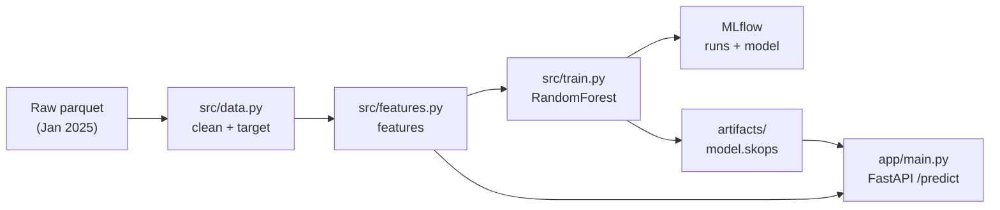

# NYC Taxi Trip Duration — Model Deployment Project

Predicts the duration (in minutes) of NYC Yellow Taxi trips from information known **when the trip starts**.
A `RandomForestRegressor` is trained on January 2025 data, tracked with MLflow, and served locally with FastAPI.



## Results

| Model | Train RMSE | Validation RMSE |
|---|---|---|
| Mean baseline (always predict the average) | – | 9.75 min |
| RandomForest — 20 trees, max_depth 10 | 4.32 min | 4.51 min |
| **RandomForest — 50 trees, max_depth 20, min_samples_leaf 5 (final)** | 3.75 min | **4.30 min** |
| RandomForest — Optuna-tuned (50 trees, max_depth 31, min_samples_leaf 2, max_features 0.5) | – | 4.19 min |

The final model is off by about **4.3 minutes** on average (RMSE), less than half the error of the mean baseline.
The small gap between train and validation RMSE shows the model is not badly overfitting.

Feature importance: `trip_distance` 0.88, `pickup_hour` 0.05, `DOLocationID` 0.02, `PULocationID` 0.02, `pickup_dow` 0.02.

## Project Structure

| Path | Purpose |
|---|---|
| `notebooks/01_eda.ipynb` | Exploration: duration distribution, outlier rule, time features |
| `notebooks/02_training.ipynb` | Baseline vs. RandomForest experiments logged to MLflow |
| `src/data.py` | Load parquet, compute `duration`, drop unrealistic trips |
| `src/features.py` | **The single place features are built**, used by training *and* the API |
| `src/train.py` | Command-line training: trains, logs to MLflow, saves the model |
| `src/tune.py` | Optuna hyperparameter search, compared against the baseline |
| `src/model.py` | Save/load the model with skops |
| `app/schemas.py` | Pydantic request/response models |
| `app/main.py` | FastAPI app with `/predict` and `/health` |
| `sample-request.json` | Example request body |
| `tests/` | pytest tests for data, features, model, and API |

## Setup

Requires [uv](https://docs.astral.sh/uv/getting-started/installation/) 0.13.5+ and Python 3.13 (see `.python-version`).

```bash
uv sync
```

Download the data into `data/` (the folder is git-ignored):

```bash
mkdir data
curl -o data/yellow_tripdata_2025-01.parquet https://d37ci6vzurychx.cloudfront.net/trip-data/yellow_tripdata_2025-01.parquet
```

> On Windows PowerShell use `curl.exe` instead of `curl`.

## Train the Model

```bash
uv run python -m src.train
```

This trains the final model (about 5 minutes on 8 CPU cores), logs the run to MLflow, and saves it to `artifacts/model.skops`.
Every setting can be changed from the command line:

```bash
uv run python -m src.train --help
uv run python -m src.train --n-estimators 100 --max-depth 25 --sample-size 0   # 0 = all rows
```

## Track Experiments with MLflow

```bash
uv run mlflow ui --backend-store-uri sqlite:///mlflow.db --port 5000
```

Open http://127.0.0.1:5000 and select the **nyc-taxi-duration** experiment.
Each run logs its hyperparameters, sample size, feature list, outlier rule, `train_rmse`, `val_rmse`, `mean_baseline_rmse`, training time, and the model.

> **Why `sqlite:///mlflow.db` and not `./mlruns`?** MLflow 3.x no longer accepts the plain file store for tracking.
> Run metadata goes to `mlflow.db`, while model files are still stored in `./mlruns`. Both are git-ignored.

## Run the API

The model has to be trained first, so that `artifacts/model.skops` exists.

```bash
uv run uvicorn app.main:app --reload --port 8000
```

Interactive docs: http://127.0.0.1:8000/docs

### Example Request

`sample-request.json`:

```json
{
  "PULocationID": 161,
  "DOLocationID": 236,
  "trip_distance": 2.5,
  "tpep_pickup_datetime": "2025-01-15T08:30:00"
}
```

```bash
curl -X POST http://127.0.0.1:8000/predict -H "Content-Type: application/json" -d @sample-request.json
```

Response:

```json
{"predicted_duration": 17.66, "unit": "minutes"}
```

Invalid input is rejected with a clear `422` error instead of a crash. For example, a missing `trip_distance` returns:

```json
{"detail": [{"type": "missing", "loc": ["body", "trip_distance"], "msg": "Field required"}]}
```

`GET /health` returns `{"status": "ok", "model_loaded": true}`.

## Run the Tests

```bash
uv run pytest
```

25 tests (about 2 seconds) cover:

- **Data:** duration is computed in minutes, and the outlier rule drops negative, zero, too-short and too-long trips and bad distances.
- **Features:** expected columns, location IDs as categorical strings, no leaky columns, and string and timestamp pickup times give identical features.
- **Model:** skops save/load round trip, longer trips predict longer durations, and a helpful error when no model is trained.
- **API:** `/health`, `200` for a valid trip, `422` for missing or invalid fields, and **API prediction == direct model prediction** (no training/serving skew).

The API tests use a tiny model trained on fake trips, so they don't need the parquet file or the real model.

## Hyperparameter Tuning (Optuna)

```bash
uv run python -m src.tune            # about 15 minutes: 20 trials + final comparison
```

Optuna searched `n_estimators` (20–150), `max_depth` (5–40), `min_samples_leaf` (1–20), and `max_features` (1.0, 0.5, 0.3, sqrt) over 20 trials, using its default TPE sampler.

To keep the validation RMSE honest, **trials never see the validation set**. Each trial trains on 40k rows from the training set and is scored on another 10k training rows.
The best settings are then retrained on the full training set and compared with the baseline on the **same validation set** that gave 4.30.
All trials are logged to MLflow as child runs of the `optuna-tuning` run.

| | Validation RMSE | Train time | Model size |
|---|---|---|---|
| Baseline (50 trees, max_depth 20, min_samples_leaf 5) | 4.296 min | 163 s | 54 MB |
| Tuned (50 trees, max_depth 31, min_samples_leaf 2, max_features 0.5) | **4.191 min** | 170 s | 158 MB |

**Was the extra complexity worth it? Not for this API.** Tuning improved RMSE by 0.105 minutes (about 6 seconds per trip, 2.4%), but the model file is about **3× larger** because of deeper trees with smaller leaves.
That means slower start-up and more memory for a gain no rider would notice. The API therefore keeps the baseline model (`artifacts/model.skops`). The tuned model is saved separately as `artifacts/model-tuned.skops`.

What the trials showed:
- `max_features=0.5` (each split sees half the features) was the biggest improvement.
- `max_features="sqrt"` and shallow trees (`max_depth` < 12) failed badly, with RMSE 6.6–8.0. With `sqrt`, a split sees only about 23 of about 520 features and often misses `trip_distance`, the most important one.

## Decisions and Tradeoffs

- **Target:** `duration` in minutes = dropoff time − pickup time.
- **Outlier rule:** keep trips with 1 ≤ duration ≤ 60 min and 0 < distance ≤ 100 miles. Zero/negative durations and multi-hour trips are data errors or unusual cases that would dominate RMSE. This keeps 3,339,105 trips.
- **Features:** pickup zone, dropoff zone, trip distance, pickup hour, and pickup day of week.
  Fares, tips, total amount, and dropoff time are **excluded** because they are only known after the trip ends (data leakage).
- **Location IDs are categories, not numbers:** they are converted to strings and one-hot encoded with `DictVectorizer`.
- **Sample size:** RandomForest training on 3.3M rows is slow, so the model is trained on a random sample of 200,000 trips (80/20 train/validation split, `random_state=42`).
- **One feature function:** `src/features.py` is used by both training and the API, so the API cannot compute features differently from training (no training/serving skew). The API returns the same prediction as calling the model directly in Python.
- **Pipeline:** `DictVectorizer` + `RandomForestRegressor` are saved as one scikit-learn `Pipeline`, so the API only has to load a single object.
- **Model format: skops instead of pickle/joblib.** Pickle can run arbitrary code when loading a file. Skops only loads types that are explicitly trusted.
  The tree type `sklearn.tree._tree.Tree` has to be trusted manually. That is fine here because we train and save the model ourselves, but a model file from an unknown source should never be trusted this way.
- **Model loading:** the model is loaded once when the API starts (FastAPI lifespan), not on every request.
- **Deployment:** the API runs directly with `uvicorn`. It is the simplest option for local development, and Docker was optional.

## Answers

### 1. What is the RMSE of your final model?

**4.30 minutes** on the validation set (20% of a 200,000-trip random sample from January 2025), compared with **9.75 minutes** for always predicting the mean duration.

### 2. What would you do differently with more time?

- **Train on all 3.3M trips** instead of a 200k sample, and check how much RMSE improves compared to the extra training time.
- **Tune for size as well as accuracy:** try the baseline settings with `max_features=0.5`, or add model size to the Optuna objective, to keep most of the RMSE gain without a 3× larger model.
- **Validate on February 2025** instead of a random split, which is closer to how the model would be used on future trips.
- **Better features:** a combined pickup–dropoff zone pair, rush-hour/weekend flags, and holidays.
- **Try other models:** gradient boosting (e.g. LightGBM/XGBoost) is usually faster and more accurate than RandomForest on tabular data.
- **Smaller model:** the current model file is about 54 MB. Limiting tree depth or the number of trees would make it faster to load and serve.
- **Docker:** package the API so it runs the same way on any machine.